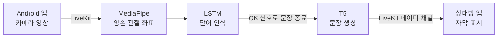

<p align="right">
<a href="README.md"></a> <a href="README.ko.md"></a>
</p>

# 실시간 한·영 수어 번역

한국 수어(KSL)와 미국 수어(ASL) 사용자가 영상 통화로 대화할 수 있도록, 손동작을 실시간으로 인식해 단어를 문장으로 만들어 상대에게 자막으로 보내는 시스템의 AI 서버입니다.

## 프로젝트 정보

| 항목 | 내용 |
| --- | --- |
| 기간 | 2025.03 ~ 2025.12 (캡스톤디자인 Ⅰ·Ⅱ) |
| 소속 | 한밭대학교 컴퓨터공학과 졸업 프로젝트 |
| 팀 | 김송이팀 3명 |
| 역할 | 팀장, AI 총괄 |

## 내가 한 일

- **팀 리딩**: 프로젝트 전체를 총괄하며 구현 가능한 기술 범위와 그렇지 않은 범위를 나누고, 팀원이 막힐 때마다 해결책을 함께 찾았습니다.
- **서버 추론 구조 제안**: 학습한 모델이 커서 처음 목표였던 온디바이스 실행이 어려워지자, 모델을 서버에 두고 앱과 네트워크로 결과를 주고받는 구조를 제안했습니다.
- **ASL 인식 파이프라인 구축**: ASL 손동작 데이터를 직접 수집하고(22개 단어와 문장 종료 신호 `OK`), LSTM 단어 인식 모델을 학습했습니다. (`ASL_translation/`)
- **ASL 문장 생성 모델 학습**: 인식된 영어 단어 나열을 문장으로 바꾸는 학습 데이터셋 689쌍을 만들고 T5 모델을 파인튜닝했습니다. 학습 곡선을 보며 과적합을 조정했습니다. (`ASL_translation/train_t5.py`, `train_dataset.json`)
- **모델 저장소 이전**: 용량이 큰 모델 파일을 Git LFS에서 Google Drive로 옮기고, KSL·ASL 코드의 모델 경로를 바꿨습니다.
- **실시간 통신 인증**: LiveKit 접속 토큰을 JWT로 발급하도록 `livekit_auth.py`를 수정했습니다.

## 팀 구성

| 이름 | 역할 | 담당 |
| --- | --- | --- |
| 이경림 | 팀장, AI 총괄 | 프로젝트 총괄, ASL 단어 인식·문장 생성, 모델 관리 |
| 송채린 | AI 개발 | KSL 데이터 수집·전처리, KSL LSTM 학습, 문장 생성 모델 탐색·학습 |
| 김하현 | 앱 개발 | Android 앱, LiveKit 기반 실시간 영상 통신, 서버 동시성 처리 |

## 문제와 해결

**문제** — 나라마다 수어가 다르지만, 서로 다른 수어 사용자가 실시간으로 대화할 수 있는 앱은 찾기 어렵습니다. 기존 연구와 특허도 대부분 단어 단위 인식에 머물러 있어 문장으로 전달하지 못합니다.

**해결** — 손동작으로 단어를 인식하는 데서 끝내지 않고, 인식한 단어들을 T5 모델로 문장으로 만든 뒤 상대방에게 보냅니다. 별도 장비 없이 스마트폰 카메라만 사용합니다.

## 시스템 구조



1. 앱이 촬영한 영상을 LiveKit으로 서버에 보냅니다.
2. MediaPipe로 프레임마다 양손 관절 좌표(2손 × 21점 × 3축 = 126값)를 뽑습니다.
3. 30프레임을 하나의 시퀀스로 묶어 LSTM이 단어를 예측합니다. 신뢰도가 기준(KSL 0.75, ASL 0.85)을 넘을 때만 단어 목록에 추가합니다.
4. `OK` 손동작이 들어오면 모은 단어를 T5에 넣어 문장을 만듭니다. T5는 화면 처리를 막지 않도록 별도 프로세스에서 돌아갑니다.
5. 완성된 문장을 LiveKit 데이터 채널로 상대방(KSL ↔ ASL)에게 보냅니다. 앱은 Google ML Kit의 한국어→영어 번역을 사용합니다.

## 모델

| 모델 | 입력 → 출력 | 구성 |
| --- | --- | --- |
| KSL 단어 인식 | 손 좌표 30프레임 → 단어 23개 + `OK` | LSTM 3층 (64-128-64) + Dense |
| ASL 단어 인식 | 손 좌표 30프레임 → 단어 22개 + `OK` | 같은 구조 |
| 문장 생성 | 단어 나열 → 문장 (예: `문장 생성: Love, you` → `I love you.`) | `paust/pko-t5-base` 파인튜닝 |

KSL 인식 대상으로 검토한 전체 단어 목록과 인식 테스트 메모는 [docs/word-list.md](docs/word-list.md)에 있습니다.

## 폴더 구조

```
├── save_sequence_data.py           # 웹캠으로 손 좌표 시퀀스 수집 (KSL)
├── preprocess_multiple_csv_lstm.py # CSV → 학습용 numpy 배열
├── train_lstm_model.py             # LSTM 단어 인식 모델 학습
├── train_t5.py                     # T5 문장 생성 모델 학습
├── realtime_predict_optimized.py   # 실시간 인식 서버 (KSL)
├── run_all_dual_hand.py            # 전처리 → 학습 → 실시간 인식 순서로 실행
├── livekit_auth.py                 # LiveKit 접속 토큰 발급
├── data/                           # KSL 단어별 손 좌표 데이터
├── models/                         # 학습된 KSL LSTM 모델 (.h5)
└── ASL_translation/                # ASL용 같은 구성 + T5 학습 데이터셋
```

## 실행 환경

- Python 3.11 (`.python-version`)
- 주요 라이브러리: TensorFlow/Keras, PyTorch, Transformers, MediaPipe, OpenCV, scikit-learn, LiveKit Python SDK, PyQt5, PyJWT
- LiveKit 서버 (`livekit-server --dev`로 실행한 로컬 개발 서버 기준)

이 레포만으로는 바로 실행되지 않습니다.

- 학습된 T5 모델 가중치는 용량 때문에 레포에 없고, Google Drive에 따로 보관했습니다.
- `realtime_predict_optimized.py` 상단의 모델 경로(`MODEL_PATH`, `ENCODER_PATH`, `T5_MODEL_PATH`)가 개발 당시 로컬 경로로 고정되어 있습니다.
- 서버 주소(`SERVER_URL`)와 LiveKit 키(`devkey`/`secret`)는 로컬 개발 서버의 기본값입니다.

## 한계와 배운 점

- **비슷한 손동작 구분**: 같은 손 모양이 들어가는 단어(나/우리, 집/기숙사/식당, 마시다/맥주)는 잘 구분하지 못했습니다. 손목을 원점으로 좌표를 바꿔 화면 위치에 따른 오인식은 줄였지만, 같은 손 모양 자체를 구분하는 문제는 남았습니다.
- **어휘 규모**: 데이터를 직접 촬영해 모으다 보니 KSL·ASL 각각 20여 개 단어에 그쳤습니다.
- **실시간 통신 구조 변경**: 처음에는 WebRTC P2P로 연결했지만, 인식 서버까지 참여하면서 연결 수와 대역폭이 급격히 늘어 지연이 생겼습니다. 그래서 SFU 서버(LiveKit)가 영상을 받아 필요한 참여자에게만 중계하는 구조로 바꿨습니다.
- **모델 파일 관리**: 모델 파일을 Git LFS에서 Google Drive로 옮기면서 모델 경로가 코드에 고정되었습니다. 경로를 설정 파일이나 환경 변수로 분리하는 것은 남은 과제입니다.

## 관련 레포

- [2025-capstone-gimsongi/sign-language-translation](https://github.com/2025-capstone-gimsongi/sign-language-translation) — 팀 원본 레포 (이 레포는 2025-12-07 최종본을 옮긴 것)
- [2025-capstone-gimsongi/Suhwagi](https://github.com/2025-capstone-gimsongi/Suhwagi) — Android 앱
- [HBNU-SWUNIV/hbnu-swuniv-capstone25-Kimsongi](https://github.com/HBNU-SWUNIV/hbnu-swuniv-capstone25-Kimsongi) — 캡스톤 보고서·발표자료
