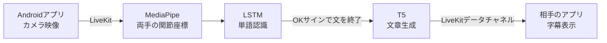

<p align="right">
<a href="README.md"></a> <a href="README.ko.md"></a>
</p>

# リアルタイム韓英手話翻訳

韓国手話（KSL）とアメリカ手話（ASL）の使用者がビデオ通話で会話できるように、手の動きをリアルタイムで認識し、単語を文章にまとめて相手に字幕として送るシステムのAIサーバーです。

## プロジェクト情報

| 項目 | 内容 |
| --- | --- |
| 期間 | 2025.03 ~ 2025.12（キャップストーンデザイン Ⅰ・Ⅱ） |
| 所属 | 国立ハンバット大学 コンピュータ工学科 卒業プロジェクト |
| チーム | 김송이（Kimsongi）チーム 3名 |
| 役割 | チームリーダー、AI統括 |

## 担当したこと

- **チームリーディング**: プロジェクト全体を統括し、実装できる技術範囲とそうでない範囲を切り分け、メンバーが行き詰まるたびに一緒に解決策を探しました。
- **サーバー推論構成の提案**: 学習したモデルのサイズが大きく、当初の目標だったオンデバイス実行が難しくなったため、モデルをサーバーに置き、アプリとネットワーク経由で結果をやり取りする構成を提案しました。
- **ASL認識パイプラインの構築**: ASLの手の動きのデータを自分で収集し（22単語と文の終了サイン `OK`）、LSTMによる単語認識モデルを学習しました。（`ASL_translation/`）
- **ASL文章生成モデルの学習**: 認識された英単語の並びを文章に変換する学習データセット689ペアを作成し、T5モデルをファインチューニングしました。学習曲線を見ながら過学習を調整しました。（`ASL_translation/train_t5.py`, `train_dataset.json`）
- **モデル保存先の移行**: 容量の大きいモデルファイルをGit LFSからGoogle Driveに移し、KSL・ASLのコード内のモデルパスを変更しました。
- **リアルタイム通信の認証**: LiveKitの接続トークンをJWTで発行するように `livekit_auth.py` を修正しました。

## チーム構成

| 名前 | 役割 | 担当 |
| --- | --- | --- |
| 이경림（Lee Kyungrim） | チームリーダー、AI統括 | プロジェクト統括、ASL単語認識・文章生成、モデル管理 |
| 송채린（Song Chaerin） | AI開発 | KSLデータ収集・前処理、KSL LSTM学習、文章生成モデルの調査・学習 |
| 김하현（Kim Hahyeon） | アプリ開発 | Androidアプリ、LiveKitによるリアルタイム映像通信、サーバーの並行処理 |

## 課題と解決

**課題** — 手話は国ごとに異なりますが、異なる手話の使用者同士がリアルタイムで会話できるアプリはほとんど見当たりません。既存の研究や特許も多くは単語単位の認識にとどまり、文章として伝えることができません。

**解決** — 手の動きから単語を認識するだけで終わらせず、認識した単語をT5モデルで文章にしてから相手に送ります。特別な機器は使わず、スマートフォンのカメラだけを使います。

## システム構成



1. アプリで撮影した映像をLiveKit経由でサーバーに送ります。
2. MediaPipeでフレームごとに両手の関節座標（2手 × 21点 × 3軸 = 126値）を抽出します。
3. 30フレームを1つのシーケンスとしてまとめ、LSTMが単語を予測します。信頼度がしきい値（KSL 0.75、ASL 0.85）を超えた場合のみ単語リストに追加します。
4. `OK` の手の動きが入力されると、集めた単語をT5に入力して文章を生成します。T5は画面処理を妨げないよう別プロセスで動作します。
5. 完成した文章をLiveKitのデータチャネルで相手（KSL ↔ ASL）に送ります。アプリではGoogle ML Kitの韓国語→英語翻訳を使用しています。

## モデル

| モデル | 入力 → 出力 | 構成 |
| --- | --- | --- |
| KSL単語認識 | 手の座標30フレーム → 23単語 + `OK` | LSTM 3層（64-128-64）+ Dense |
| ASL単語認識 | 手の座標30フレーム → 22単語 + `OK` | 同じ構成 |
| 文章生成 | 単語の並び → 文章（例: `문장 생성: Love, you` → `I love you.`。`문장 생성` は「文章生成」を意味する入力プレフィックス） | `paust/pko-t5-base` をファインチューニング |

KSLの認識対象として検討した全単語リストと認識テストのメモは [docs/word-list.md](docs/word-list.md) にあります。

## フォルダ構成

```
├── save_sequence_data.py           # Webカメラで手の座標シーケンスを収集（KSL）
├── preprocess_multiple_csv_lstm.py # CSV → 学習用numpy配列
├── train_lstm_model.py             # LSTM単語認識モデルの学習
├── train_t5.py                     # T5文章生成モデルの学習
├── realtime_predict_optimized.py   # リアルタイム認識サーバー（KSL）
├── run_all_dual_hand.py            # 前処理 → 学習 → リアルタイム認識の順に実行
├── livekit_auth.py                 # LiveKit接続トークンの発行
├── data/                           # KSL単語ごとの手の座標データ
├── models/                         # 学習済みKSL LSTMモデル（.h5）
└── ASL_translation/                # ASL用の同じ構成 + T5学習データセット
```

## 実行環境

- Python 3.11（`.python-version`）
- 主なライブラリ: TensorFlow/Keras, PyTorch, Transformers, MediaPipe, OpenCV, scikit-learn, LiveKit Python SDK, PyQt5, PyJWT
- LiveKitサーバー（`livekit-server --dev` で起動したローカル開発サーバーを前提）

このリポジトリだけではそのまま実行できません。

- 学習済みT5モデルの重みは容量の都合でリポジトリに含めず、Google Driveに別途保管しています。
- `realtime_predict_optimized.py` 冒頭のモデルパス（`MODEL_PATH`, `ENCODER_PATH`, `T5_MODEL_PATH`）が開発当時のローカルパスに固定されています。
- サーバーアドレス（`SERVER_URL`）とLiveKitのキー（`devkey`/`secret`）はローカル開発サーバーのデフォルト値です。

## 限界と学んだこと

- **似た手の動きの区別**: 同じ手の形を含む単語（私/私たち、家/寮/食堂、飲む/ビール）はうまく区別できませんでした。手首を原点として座標を変換することで画面上の位置による誤認識は減らしましたが、同じ手の形そのものを区別する問題は残りました。
- **語彙の規模**: データを自分たちで撮影して集めたため、KSL・ASLそれぞれ20語あまりにとどまりました。
- **リアルタイム通信構成の変更**: 当初はWebRTCのP2Pで接続していましたが、認識サーバーまで参加することで接続数と帯域が急増し、遅延が発生しました。そこで、SFUサーバー（LiveKit）が映像を受け取り、必要な参加者にだけ中継する構成に変更しました。
- **モデルファイルの管理**: モデルファイルをGit LFSからGoogle Driveに移した際、モデルパスがコードに固定されてしまいました。パスを設定ファイルや環境変数に分離することは今後の課題です。

## 関連リポジトリ

- [2025-capstone-gimsongi/sign-language-translation](https://github.com/2025-capstone-gimsongi/sign-language-translation) — チームの元リポジトリ（このリポジトリは2025-12-07時点の最終版を移したもの）
- [2025-capstone-gimsongi/Suhwagi](https://github.com/2025-capstone-gimsongi/Suhwagi) — Androidアプリ
- [HBNU-SWUNIV/hbnu-swuniv-capstone25-Kimsongi](https://github.com/HBNU-SWUNIV/hbnu-swuniv-capstone25-Kimsongi) — キャップストーンの報告書・発表資料
